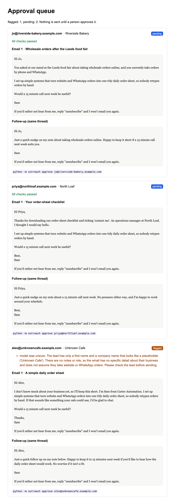
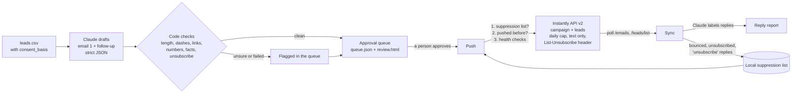
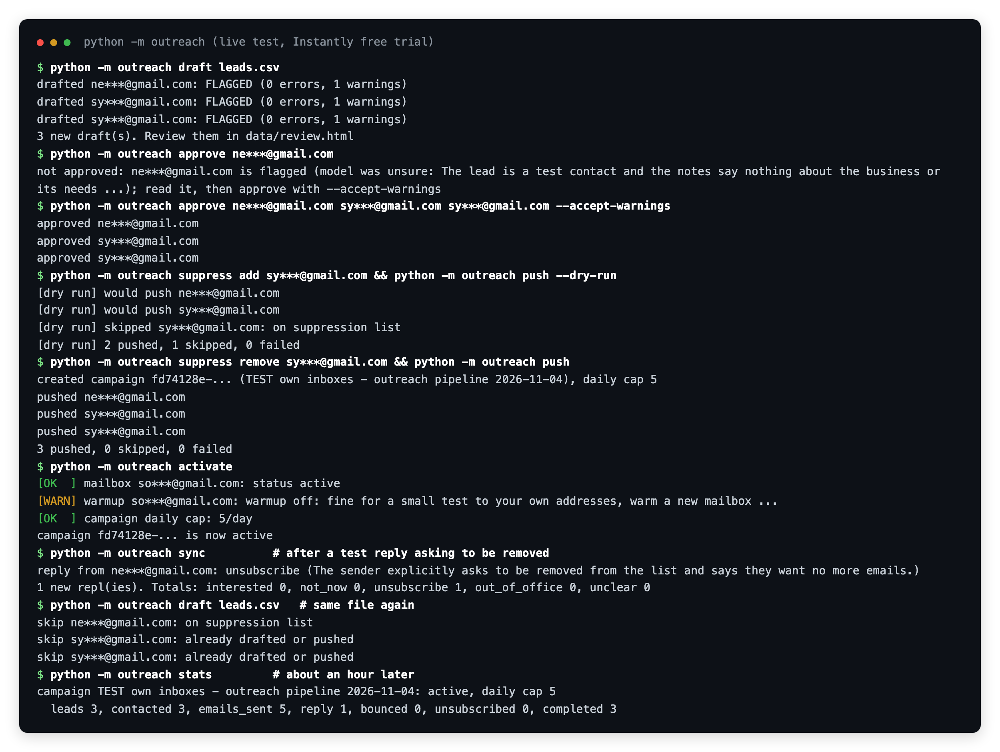

# AI Cold Outreach with Instantly (with a human approval step)

A small, careful cold-email pipeline in Python. Claude writes a short personalised first email and one follow-up for each lead, every draft is checked by code, a person approves it, and only then is the lead added to an [Instantly](https://instantly.ai) campaign through the Instantly API v2. Bounces, unsubscribes and replies come back by polling the API, Claude sorts the replies, and a local suppression list makes sure nobody who asked to stop is ever pushed again.



## How it works



1. **Leads in.** A CSV with `email, first_name, company, consent_basis` (plus optional `last_name, role, website, notes`). `consent_basis` is required on purpose: each row has to say why this person can be emailed. Rows without it, bad addresses and duplicates are rejected before anything else happens.
2. **Drafting.** Claude (`claude-sonnet-5-5`) gets only the lead's own fields and the sender's offer, and must answer in a fixed JSON shape: subject, first email, follow-up, the list of facts it used (each copied from a named lead field), and an `unsure` flag with a reason. If the lead row is thin, it is told to say so instead of guessing.
3. **Checks in code, not trust.** Every draft is checked:
   - subject 60 characters or less, first email 35 to 130 words, follow-up 12 to 80 words
   - no em or en dashes, no `{{placeholders}}` left in
   - no link and no number that is not in the lead row or the sender's own text
   - every "fact used" must really appear in the lead field it names
   - both emails end with the exact unsubscribe line
   - capitalised names or terms that are not in the lead row, spam-trigger wording, and a missing first name are flagged for a person to look at

   A failed draft is sent back to Claude once with the list of problems; if it still fails, it goes into the queue as **flagged** rather than being dropped or silently fixed.
4. **Approval queue.** Drafts land in `data/queue.json` and a readable `data/review.html`. Nothing is pushed until a person runs `approve`. Clean drafts can be approved in one go (`approve --all-clean`); flagged drafts must be approved one at a time with `--accept-warnings`, and drafts with errors cannot be approved at all until someone edits them. Approving re-runs the checks, so a hand-edited draft is checked again.
5. **Push.** Before any API call: health checks (mailbox connected and active, warmup state, the campaign's daily cap is not above your setting, the campaign only sends from your listed mailboxes). Then for each approved lead: skip it if it is on the suppression list, skip it if the local ledger says it was pushed before, and also ask Instantly to skip it if it is already in the workspace. The campaign is created once with the sequence (`{{subject_1}}` / `{{body_1}}`, then `{{body_2}}` as a reply in the same thread), a sending window and timezone, the daily cap, plain-text sending, open and link tracking off, stop on reply, and Instantly's List-Unsubscribe header. Each lead carries its own approved text as custom variables.
6. **Sync.** Polls the API for lead statuses (bounced and unsubscribed leads go on the local suppression list) and for received emails. Each new reply is labelled by Claude as `interested`, `not_now`, `unsubscribe`, `out_of_office` or `unclear` (anything it is not sure about), quoted history is stripped first, each reply is only classified once, and `unsubscribe` replies are suppressed straight away. The result is written to `data/reply-report.md`.

**Why polling and not webhooks:** Instantly only offers webhooks on its higher paid plans (Hypergrowth and up at the time of writing), not on the free trial or the entry plan. Polling `GET /emails` and `POST /leads/list` on a schedule (cron or launchd, every 15 to 30 minutes is plenty) works on every plan. If you have webhooks, the same `poll_replies` and `sync_lead_statuses` logic can be called from a webhook handler instead.

**Dry run:** `push --dry-run` and `activate --dry-run` run the health checks and show exactly what would happen, with no write calls to Instantly.

## Quick start

```bash
python3 -m venv .venv && source .venv/bin/activate
pip install -r requirements.txt -r requirements-dev.txt
pytest -q                                    # 71 tests, no network, no keys
```

Keys come from environment variables or the macOS Keychain (nothing is written to disk):

```bash
security add-generic-password -s instantly-api-key -a "$USER" -w     # prompts for the key
security add-generic-password -s anthropic-api-key -a "$USER" -w
export INSTANTLY_KEYCHAIN_ACCOUNT="$USER"
```

The Instantly key needs the scopes `campaigns`, `leads`, `lead_lists`, `accounts` and `emails`. Connect your sending mailbox in Instantly first.

```bash
cp samples/campaign.example.json campaign.json      # edit sender, offer, mailbox, cap, window
python -m outreach draft samples/leads.example.csv  # drafts into the approval queue
python -m outreach review                            # list + data/review.html
python -m outreach approve --all-clean               # or: approve someone@example.com --accept-warnings
python -m outreach health                            # mailbox, warmup, caps
python -m outreach push --dry-run
python -m outreach push                              # creates the campaign once, adds approved leads
python -m outreach activate
python -m outreach sync                              # bounces, unsubscribes, replies -> report
python -m outreach stats
python -m outreach suppress add someone@example.com --reason "asked by phone"
python -m outreach teardown --yes                    # pause and delete the campaign and its leads
```

Add `--mask` before the command to mask email addresses in the output (handy for screenshots).

> **A note on Instantly's API:** it sits behind Cloudflare, which blocks Python's default `python-requests` User-Agent with "error code: 1010". The client always sends its own User-Agent. If you write your own calls and get a 403 with 1010, that is why.

## Status

Tested live on 4 November 2026 against an Instantly free trial, sending only to my own three test inboxes from my own connected Gmail mailbox:

- **Drafting:** Claude drafted all three test leads; all three were correctly **flagged** as unsure, because the test rows had no real business details, and it said so instead of making things up. On the example leads in `samples/` (real Claude output, shown above), the two leads with real notes came back clean and the thin one was flagged. The CSV loader rejected a bad address and a row with no consent basis.
- **Approval gate:** approving a flagged draft without `--accept-warnings` was refused; after reading them, I approved all three by hand.
- **Suppression before push:** with one test address on the suppression list, `push --dry-run` showed it skipped and the other two going through, with no write calls.
- **Push:** created a real campaign through `POST /campaigns` (two-step sequence, follow-up in the same thread, Asia/Dubai sending window, daily cap 5, plain text, tracking off, List-Unsubscribe header), added the three leads with their approved text as custom variables, and activated it. Re-adding a lead that was already in the workspace returned the existing lead and created no duplicate (the local ledger blocks that case before the call anyway).
- **Delivery:** Instantly sent all three first emails about 9 minutes apart. The one to the inbox I can read arrived intact: correct line breaks, apostrophes and quotes, the unsubscribe line, and a List-Unsubscribe header ([what it looked like](media/delivered-email.png)). **It landed in Gmail's Spam folder**, which is what you would expect from a brand new Gmail mailbox with warmup off, and is exactly why the health check warns about warmup. The other two went to inboxes I cannot read from here: Instantly reports them sent with no bounce.
- **Reply handling:** I replied to one test email asking to be taken off the list. Instantly picked the reply up, `stop_on_reply` stopped that lead's follow-up (that inbox got exactly one email), `sync` found the reply by polling `GET /emails`, Claude labelled it `unsubscribe`, and the address went onto the suppression list. Running `draft` on the same CSV again then skipped it. A second `sync` reclassified nothing.
- **Follow-ups and cap:** the two other leads got their follow-up as a `Re:` in the same thread about 44 minutes after the first email (a 40 minute delay was used for the test). Instantly's stats read back through the API: 3 leads, 3 contacted, 5 emails sent (exactly the daily cap of 5), 1 reply, 0 bounced, 0 unsubscribed, 3 completed.
- **Teardown:** `teardown --yes` paused and deleted the campaign and its three leads; the workspace was checked afterwards and was empty. The sending mailbox and its settings were left alone, with warmup still off.
- **Plan limits:** nothing this project uses was blocked on the free trial.



**What is not proven here:** real prospecting volume, deliverability at scale, mailbox warmup (left off on purpose for this test), custom sending domains, and Smartlead (not built; the same design would carry over, but it has not been written or tested). Webhooks were not tested (not available on the trial).

## Limitations

- One campaign per data folder. Run separate campaigns from separate `--data-dir` folders.
- Reply polling reads the latest 100 received emails per run. Run `sync` often enough that this covers the gap (every 15 to 30 minutes is far more than enough at these volumes).
- The fact checks are deliberately strict and simple (exact text, numbers, links, capitalised names). They catch invented specifics; they cannot judge tone or whether an offer is a good fit. That is what the human approval step is for.
- The approval step is a CLI plus a read-only HTML page. For a team, the same queue file could sit behind a small web form or a shared sheet.
- The local suppression list is separate from Instantly's own blocklist. It is checked before every push, so it works on any plan.

## Compliance (please read before using this on real people)

This is not legal advice, but these are the basics the tool is built around:

- **Only email people who have a reason to hear from you.** In the UK and EU (UK GDPR, EU GDPR, PECR and the ePrivacy rules), emailing individuals generally needs consent; business-to-business email to corporate addresses can rely on legitimate interest, but you must do and record a balancing test, tell people where you got their details, and stop the moment they object. That is why every lead row must carry a `consent_basis`.
- **United States (CAN-SPAM):** no misleading headers or subject lines, say who you are, include a physical postal address in your sign-off, give a working way to opt out, and honour opt-outs within 10 business days.
- **UAE:** the TDRA's rules on unsolicited marketing and the UAE data protection law (PDPL) expect consent or a clear existing relationship, a working opt-out, and messages that identify the sender.
- **Every email here has an unsubscribe line and Instantly's List-Unsubscribe header.** Unsubscribe replies, Instantly unsubscribes and bounces all land on the local suppression list, and that list is checked before any lead is pushed.
- **Never scrape, never buy lists, never email people who did not ask for it.** This project does not scrape anything and should not be fed scraped data.
- Keep volumes low and warm new mailboxes before any real outreach. The default daily cap is 5.

## Instantly plan facts (as of November 2026)

- Free trial: 14 days, no card needed. It allowed everything this project uses: creating campaigns, adding leads, activating and sending, reading emails and lead statuses through API v2. Trial limits on the account used: 250 uploaded contacts and 1,000 emails.
- API v2 is included from the Growth plan ($47 a month, or $37.60 a month billed yearly; 1,000 uploaded contacts and 5,000 emails a month). Hypergrowth ($107 a month, 25,000 contacts, 125,000 emails) is the plan Instantly's materials give for webhooks.
- Prices and limits change; check Instantly's pricing page before you buy.

## Project layout

```
outreach/
  leads.py      CSV loading and checks (consent_basis required)
  drafting.py   Claude prompt, strict JSON parsing, one retry with the failed checks
  validate.py   every rule a draft must pass, errors vs warnings
  approval.py   the queue (queue.json) and the review page
  instantly.py  API v2 client: custom User-Agent, retries on 429/5xx, plan-limit errors
  health.py     mailbox, warmup and cap checks before push and activate
  push.py       campaign payload, lead payload, suppression and duplicate guards, dry run
  replies.py    polling, reply classification, suppression sync, report
  store.py      SQLite: suppression list, push ledger, replies, state
  cli.py        python -m outreach ...
samples/        example campaign settings and example leads (example.com addresses)
tests/          71 tests, Instantly and Claude mocked
```

## Tests

`pytest -q` runs 71 tests with no network: the CSV rules; every draft check (dashes, links, numbers including "1" not matching inside "15", facts that are not in the lead row, placeholders, word limits, unknown names, unsure model, spam wording); the drafting retry paths (bad JSON, failed checks fed back, cut-off reply, thinking blocks ignored); the approval rules (flagged needs `--accept-warnings`, errors block, edited drafts re-checked, HTML escaped, addresses masked); the API client with mocked HTTP (Bearer and User-Agent headers, 429 with Retry-After, 5xx, network errors, no retry on 400, Cloudflare 1010, plan-limit errors, pagination, the key never in `repr`); push (nothing without approval, suppressed leads never reach the API, the ledger stops duplicates even if someone re-approves, dry run makes no write calls, failures stay retryable); health; reply polling, classification and suppression; and the whole CLI flow end to end. GitHub Actions runs `ruff` and the tests on Python 3.9 and 3.12.

## Stack

Python 3.9+ · Instantly API v2 · Anthropic Claude (`claude-sonnet-5-5`) · SQLite · pytest + responses · ruff · GitHub Actions

---
Part of a small portfolio of tested automation and AI builds; see [ParishSynthMind](https://github.com/ParishSynthMind) for the others.
